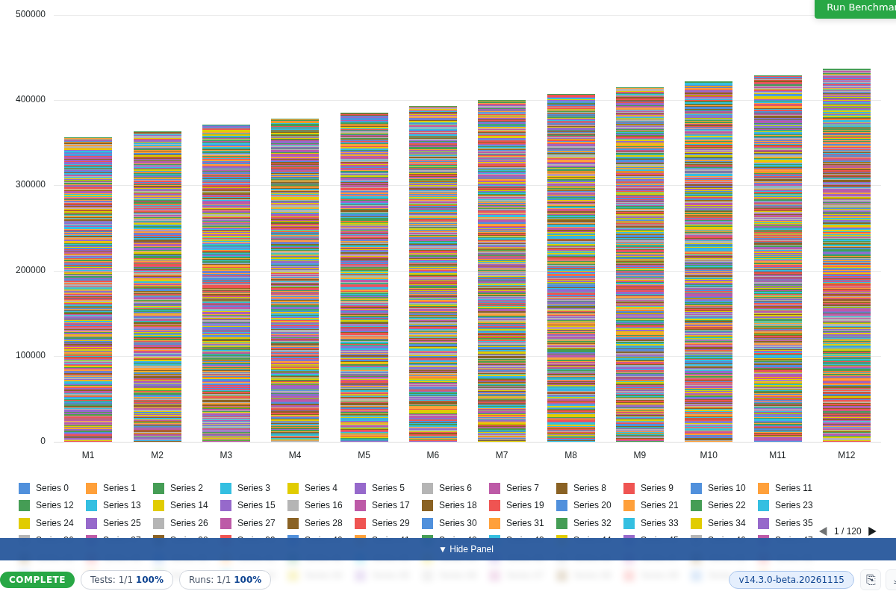

# Stacked-series contribution: canonical source and final latest integration

**PR source: [`kirill/perf-stacked-series`](https://github.com/popkir/ag-charts/tree/kirill/perf-stacked-series), head [`64f85dea`](https://github.com/popkir/ag-charts/commit/64f85dea3b32382b6ef4169c0f684ee4a21e4e87).** It includes upstream `latest` at `d78787368dc6b5ff88d6dbe144df639d8dd012cf`. The [complete PR diff](https://github.com/popkir/ag-charts/compare/d78787368dc6b5ff88d6dbe144df639d8dd012cf...64f85dea3b32382b6ef4169c0f684ee4a21e4e87) remains **thirteen code/test files**, with no reports, archives, benchmark harnesses or workflow helpers. Four performance commits are followed by two upstream synchronisation merges; both merges were conflict-free and the full-index contribution patch remains byte-identical. [Merge proof](./merge-proof.json).

## Branches after cleanup

| Branch | Purpose |
| --- | --- |
| [`kirill/perf-stacked-series`](https://github.com/popkir/ag-charts/tree/kirill/perf-stacked-series) | **The single PR source**, fork default; submit against `ag-grid/ag-charts:latest` |
| [`kirill/evidence-stacked-series`](https://github.com/popkir/ag-charts/tree/kirill/evidence-stacked-series) | Reports, raw archives, recoverable Git history and verification workflow; excluded from the PR |
| `latest` | Legacy fork reference retained by explicit owner decision; not the PR source |

Seventeen obsolete technical branches and duplicate source aliases were removed. Local and remote branch names match the three rows above. [Exact cleanup and owner decision](./branch-cleanup.json). Do not submit the evidence branch or the retained fork `latest` as the PR source. Only the actual upstream branch is the target.

## Verification of the exact final source

[Workflow 43859617103](https://github.com/popkir/ag-charts/actions/runs/43859617103) checked actual source tree `6fb9460609781a08e2f479f224b5430edb1ee744`. Checkout guards verify the pinned source commit/tree and absence of tracked runtime edits. The workflow/harness is on the evidence branch; it does not enter the contribution. [Pinned CI source manifest](./ci-manifest.json) · [original workflow snapshot](./actions/43859617103/workflow.yml).

Official format/check, Community/Enterprise types and lint passed. Complete native suites: **14548 passed, 68 skipped**, zero failures. Complete Chromium website E2E: **5192 passed, 8 skipped, 9 failed, 0 flaky**, all eight shards and six framework variants. Standard Firefox/WebKit: **220 passed, 24 skipped, 2 failed, 0 flaky**.

**Browser jobs remain red.** Every one of the eleven stable failures occurs on unmodified current target `d7878736`: eight keyboard-navigation/focus cases, plus tooltip hover in Chromium, Firefox and WebKit. All failure case sets match; the actual, expected and diff PNGs match across all three attempts: **99 byte-identical images**. No snapshot reference, tolerance, selection or retry policy was changed in this contribution. [Full comparison](./upstream-comparison.json) and [all statistics/cases](./verification-summary.json). This is baseline attribution, not upstream CI approval or a diagnosis of the original screenshot discrepancy.

## Direct latest-to-contribution full-browser result

**110.8734 → 21.8631 seconds: 5.071×, 80.28% less render time.** This is a direct comparison of unpatched target `d7878736` and actual final `64f85dea` on one VM, not multiplied historical ratios.

The fixture contains 7293 actual stacked bar series × 12 categories, all 87516 positive datum rectangles, legend enabled and animations disabled. Ordinary legend pagination remains; 7293 enabled legend records are not 7293 items drawn on one page. Chart 1200×800, DPR 1, viewport 1280×960. Both official Nx UMDs were built directly from pinned source with `yarn nx build:umd ag-charts-enterprise --skip-nx-cache`; source/tree and installed bundle hashes were checked.

Three pairs ran sequentially with a fresh Chromium process per render; pair 2 reversed order. Primary boundary: chart creation through public `waitForUpdate()` plus two browser animation frames. Library loading, fixture generation, separate 32-series warmup/destruction/GC and evidence capture are outside timing. No tracing, CPU profiling or heap sampling was enabled during canonical measurements.

| Pair | Order | Unpatched latest | Contribution | Paired speedup |
| --- | --- | ---: | ---: | ---: |
| 1 | latest → contribution | 110.1740s | 21.8631s | 5.039× |
| 2 | contribution → latest | 110.8734s | 21.7072s | 5.108× |
| 3 | latest → contribution | 112.2352s | 22.2204s | 5.051× |
| **Median per side** | — | **110.8734s** | **21.8631s** | **5.071×** |

Complete inputs/options, full scenes, geometry, public states and PNG bytes match for all pairs; zero pixel differences. All six raw input files were independently checked for all 87516 values, all scene/PNG hashes recomputed, and a full representative scene parsed to verify every positive rectangle. The equality of complete scene hashes establishes equivalence of the remaining scenes. [Independent audit, raw medians, builds and paired ratios](./performance-audit.json).

Host: `INTEL(R) XEON(R) PLATINUM 8573C`, 4 logical CPUs, 15983 MiB RAM; headless software Chromium `148.0.7778.96`. Three runs per side on one VM establish this synthetic initial-render observation. The remaining roughly 22-second render is still substantial; this does not measure real CLIMATISE page loading or GPU acceleration.

Earlier separately measured results remain historical: [original FD→pre-sync 52f](../total-render-final/README.md), 125.0086→24.8994s, 5.021×; [first integration 9ee→AE](./revisions/ae4e8907/README.md), 100.0997→20.5486s, 4.871×. Hosts and source revisions differ; these are not multiplied or subtracted to produce the current result.

## Actual final-render screenshot



Original `run3-head.png` from the final CI render, not a mockup or customer screenshot. All 87516 positive datum rectangles remain in the scene; normal legend pagination shows one page at a time. The unpatched and patched PNGs are byte-identical. [Exact archive member, source and SHA-256](./screenshot-provenance.json).

## Behaviour and source handoff

The initial property/invalidity-reference prefilters retain the full original compatibility predicates, order, dataset/transform boundaries and all aggregate IDs/scopes. Scope-column indexing and the shared stateless range function preserve signed stacks, visibility, bigint endpoints and caller-owned output tuples. The follow-ups batch legend writes while preserving intermediate reads and error paths, index missing definitions with legacy unscoped fallback and live definition references, and reuse unchanged group scales with real-change invalidation and scalar snapshots for in-place grouping mutations. Existing SDK entry points, all data/features and zero external runtime dependencies remain.

The earlier 27 complete prototype renders and 13-stage interaction/export matrix are retained in the [optimisation history](../optimization-validation/README.md). Current native and complete browser coverage above tests the actual merged source. No historical prototype time is relabelled as an actual new-head measurement.

Fetch only the source branch for review:

```sh
git fetch https://github.com/popkir/ag-charts.git kirill/perf-stacked-series
```

The four logical performance commits remain `bec53b4495a6866beeeb1dcd727de6162b2dd3bd`, `d65edede3fdeec26a5fb490becbba093687c7a6a`, `b4aa2cdb0b84e29f727c93ab8bd302a6d935978a` and `52f45beae1fd50b3a23b678219f5d1b81ffea509`. These commit references preserve the technical investigation. David has since clarified that company policy excludes external PRs and cherry-picks; they are not a pending accepted submission route.

## Permanent evidence

The archive now retains **119 original ZIPs across 31 workflow runs**, 627,634,734 bytes, plus the 105881-byte recoverable Git bundle. Original ZIP bytes were preserved; SHA-256, available GitHub artifact digests and ZIP CRCs were checked. Full Playwright HTML reports, nested traces, JUnit, native logs, complete run logs, UMD/maps, raw input/scene/PNG files and failed attempts remain outside the PR. [Current run manifest](./actions/43859617103/archive-manifest.json) · [all jobs](./actions/43859617103/jobs.json) · [checksums for both integration runs and branch bundle](./SHA256SUMS).

Open an archive and use Download raw file. Extract its directory structure intact before opening a Playwright report/trace viewer; full scene and input JSON are gzip-compressed.

| Current run original archive | Bytes |
| --- | ---: |
| [run-logs.zip](./actions/43859617103/run-logs.zip) | 2445767 |
| [stacked-merged-build-base.zip](./actions/43859617103/stacked-merged-build-base.zip) | 3745009 |
| [stacked-merged-build-head.zip](./actions/43859617103/stacked-merged-build-head.zip) | 3748232 |
| [stacked-merged-cross-browser.zip](./actions/43859617103/stacked-merged-cross-browser.zip) | 3008660 |
| [stacked-merged-e2e-1.zip](./actions/43859617103/stacked-merged-e2e-1.zip) | 2252196 |
| [stacked-merged-e2e-2.zip](./actions/43859617103/stacked-merged-e2e-2.zip) | 2605201 |
| [stacked-merged-e2e-3.zip](./actions/43859617103/stacked-merged-e2e-3.zip) | 1920530 |
| [stacked-merged-e2e-4.zip](./actions/43859617103/stacked-merged-e2e-4.zip) | 2146324 |
| [stacked-merged-e2e-5.zip](./actions/43859617103/stacked-merged-e2e-5.zip) | 2070374 |
| [stacked-merged-e2e-6.zip](./actions/43859617103/stacked-merged-e2e-6.zip) | 1994159 |
| [stacked-merged-e2e-7.zip](./actions/43859617103/stacked-merged-e2e-7.zip) | 2169994 |
| [stacked-merged-e2e-8.zip](./actions/43859617103/stacked-merged-e2e-8.zip) | 32610713 |
| [stacked-merged-native.zip](./actions/43859617103/stacked-merged-native.zip) | 345648 |
| [stacked-merged-quality.zip](./actions/43859617103/stacked-merged-quality.zip) | 3103 |
| [stacked-merged-render-results.zip](./actions/43859617103/stacked-merged-render-results.zip) | 8854960 |
| [stacked-merged-upstream-baseline.zip](./actions/43859617103/stacked-merged-upstream-baseline.zip) | 24103870 |

[First integration’s 16 original archives](./revisions/ae4e8907/README.md#permanent-original-archives) · [earlier retained archives and original checksums](../optimization-validation/ARCHIVES.md). Commit-pinned copies do not depend on Actions artifact expiry. The separate [successful archive publisher log](./publisher/43868356928/run-logs.zip) is housekeeping provenance, additional to the 119 verification ZIPs.

## Recovering deleted technical branches

[Branch backup](./branch-backup.json) records all original candidates and 17 named deleted helper/alias heads. [obsolete-branches.bundle](./obsolete-branches.bundle) is a verified thin Git bundle with prerequisite `fd652e876a2b059924848a2177c82e67d6752327`, which remains in both source ancestry and the owner-retained fork `latest`. Its 17 heads restore every deleted branch without leaving throwaway branches/tags in the fork. All prior helper/workflow source snapshots and original report ZIPs remain archived too.

```sh
git bundle verify artifacts/stacked-series/consolidation/obsolete-branches.bundle
git bundle list-heads artifacts/stacked-series/consolidation/obsolete-branches.bundle
git fetch artifacts/stacked-series/consolidation/obsolete-branches.bundle refs/remotes/personal/kirill/benchmark-total-stacked-final:refs/heads/restored-benchmark
```

## Upstream response and remaining gates

[Enterprise customer follow-up with the actual final screenshot](https://github.com/ag-grid/ag-charts/issues/9096#issuecomment-6916901903) was posted by `popkir`; the issue description and earlier result comments now identify the exact final source and verification. [Publication receipt](./publication-receipt.json) · [all 119 published original Git blobs checked against local bytes](./published-archives-audit.json).

[David’s response](https://github.com/ag-grid/ag-charts/issues/9096#issuecomment-6915125807) states that company policy excludes external PRs, collaborator access and cherry-picking external commits. The issue was closed and David asked for a real-world use case. There is no accepted upstream PR route at present.

CLIMATISE is an Enterprise customer (confirmed by the owner). The shareable use case is monthly analytics with separate series for breakdown members and a small number of periods; the public 7293-series fixture is synthetic. The follow-up requests a substantive technical assessment and a clear Enterprise escalation route. No client data, licence details or account credentials are published.

[Public activity audit](./UPSTREAM_ACTIVITY.md) identifies Alan Treadway as the actual merger of the four inspected latest PRs; iMoses authored the newest two. David is already responding in this issue, so the follow-up stays in that conversation. No maintainer/admin rights are requested.

Fork verification does not constitute upstream CI approval or maintainer acceptance. No upstream PR, merge, release or deployment has occurred. Source and target references identify the exact tested revisions; live upstream can advance afterward.
