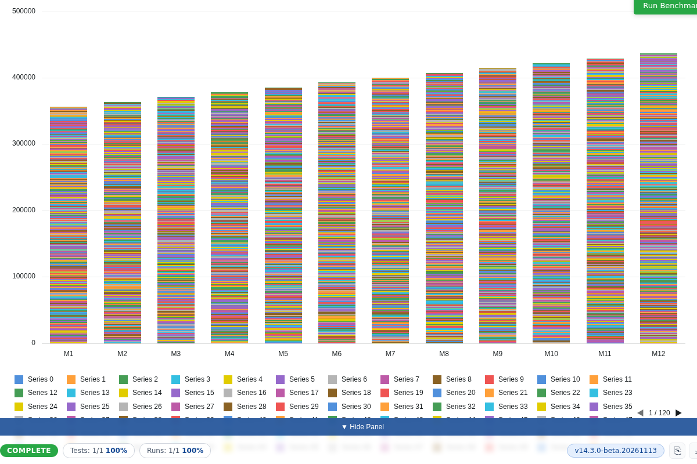

> Historical measurement of the initial data-preparation patch at `bec53b44`. For the current four-commit contribution, additional rendering optimisations and complete E2E attribution, see the [current report](../optimization-validation/README.md). The historical measurements below are unchanged.

# Full browser rendering: 7293 stacked series

The paired full-render benchmark passed. Median chart creation through settled update plus two browser animation-frame callbacks improved from **123.806 s to 51.014 s**: **2.427×**, or **58.8% less time**.

The candidate still takes about **51 seconds** for this deliberately extreme workload. This establishes a substantial improvement; it does not establish interactive-speed rendering or identify the remaining bottlenecks.

[Successful run](https://github.com/popkir/ag-charts/actions/runs/43774538081) · [exact benchmark helper commit](https://github.com/popkir/ag-charts/commit/4c89501c8c0819d51762a7ee2afdd7491dbb6874) · [raw summary](./results/summary.json) · [complete permanent reports and logs](../actions/README.md).

## Pinned scenario and runtime

- Baseline: `fd652e876a2b059924848a2177c82e67d6752327`.
- Candidate: `bec53b4495a6866beeeb1dcd727de6162b2dd3bd`.
- 7293 ordinary vertical stacked bar series, one stack, 12 categories, 87516 numeric points, every series enabled.
- The same deterministic positive data formula as the source preparation benchmark: `value = (seriesIndex % 97) + categoryIndex + 1`.
- Legend enabled with normal pagination; animation disabled. Chart/canvas 1200 × 800, viewport 1280 × 960, DPR 1, fixed local Arial font.
- Headless Chromium `148.0.7778.96`, software rendering, Node 24.22.3, Ubuntu 24.04.
- One VM: AMD EPYC 7763 64-Core Processor; 4 vCPUs, 15984 MiB RAM.
- The exact archived source-built UMD bundles were reused. ZIP, UMD and shared-helper SHA-256 values were verified; the runtime bundles were not edited. [Build receipts](./results/build-receipts.json).

Three sequential pairs ran on one VM, with a fresh Chromium process for each measurement. Pair 2 reversed the order. Each process first rendered and destroyed a separate 32-series warmup chart, then ran GC outside the measured interval. The two 32-series pilot measurements are excluded from the summaries.

## Boundaries and results

The benchmark calls the unchanged upstream `performInitialLoad` helper: `AgCharts.create(options)` through the public `waitForUpdate()` completion promise. That promise waits for pending chart changes to be rendered. A wider measurement ends after two subsequent `requestAnimationFrame` callbacks.

The interval includes target chart construction, options handling, data processing, axis and legend layout, series geometry and canvas rendering. Library loading, data/option generation, font readiness, warmup, GC, evidence capture and scene audits are outside it. Tracing is enabled only for the excluded pilot; canonical timings have no tracing or heap sampling.

| Boundary | Baseline median (min–max), s | Candidate median (min–max), s | Ratio of medians |
| --- | ---: | ---: | ---: |
| Create → `waitForUpdate` | 123.577 (123.252–123.689) | 50.734 (50.525–51.716) | 2.436× |
| Create → update + two frames | 123.806 (123.475–123.910) | 51.014 (50.761–51.942) | 2.427× |

| Pair and execution order | Baseline, update + two frames (s) | Candidate, update + two frames (s) |
| --- | ---: | ---: |
| 1: baseline, candidate | 123.910 | 51.942 |
| 2: candidate, baseline | 123.475 | 50.761 |
| 3: baseline, candidate | 123.806 | 51.014 |

These are three observed runs per side on one fixed host, not a statistical-significance or cross-device guarantee. CPU-steal readings were zero for all six measurements; raw CPU-pressure observations are retained per run.

## Completeness and visual equivalence

All six canonical renders completed, without browser exceptions. Every one passed checks for:

- 7293 configured yKeys and 7293 entries in the actual legend state, all visible.
- 7293 actual series in the upstream read-only E2E scene snapshot.
- Exactly 12 category bar datum nodes per series: all 87516 retained, with finite, positive-sized rectangles.
- Identical input/options hashes and complete bar-geometry hashes between each pair.
- Byte-identical complete scene snapshots and PNG screenshots between each pair.
- Zero differing pixels across the 1200 × 800 screenshot at the upstream 0.05 colour threshold, with anti-alias differences included.

[Independent retained-data audit](./independent-audit.json) recomputed the medians and re-read all six compressed scene snapshots, including every datum rectangle and legend entry.

[Pair 1](./results/run1-comparison.json) · [pair 2](./results/run2-comparison.json) · [pair 3](./results/run3-comparison.json).

Candidate screenshot, unedited; the upstream benchmark controls remain visible and the legend uses its normal pagination:

Raw per-run JSON reports, before/after PNGs and difference images are under [results](./results). The full ZIP also retains every gzip-compressed scene snapshot, console output and pilot trace.

## Reproduce and inspect

[Benchmark source snapshot](./harness) · [source manifest](./source-manifest.json). The original helper commit above is runnable directly. To reconstruct it from this evidence checkout, copy `harness/tools/full-render-7293` to `tools/full-render-7293`, then follow its README. The shared upstream tools are present in the pinned repository source.

The permanent archive retains both the initial failed 32-series layout pilot (wrapper stretched to 1248 px despite a 1200 px canvas) and the corrected successful run. The fixed fixture constrains the DOM container as well as chart options. No failed or partial 7293-series render is excluded from the canonical results; all six completed and passed.

## How this relates to the other figures

| Experiment | Measured result |
| --- | --- |
| Source preparation only, 7293 × 12, `DataController.execute` | 95.613 s → 0.263 s, about 364× |
| Complete browser chart creation, same input shape, legend on | 123.806 s → 51.014 s, about 2.43× |
| Earlier official browser example, only 2 series × 100000 rows | Chart create 164.8 → 152.7 ms; zoom 378.6 → 374.2 ms |

The source-only experiment was run on a different machine and covers a narrower phase. Its 364× ratio must not be applied to total browser rendering, nor can its milliseconds be subtracted from the browser results. The remaining approximately 51-second latency needs separate profiling before its causes can be assigned.

## Submission readiness

The source contribution remains exactly one commit and six code/test files. No benchmark scripts, screenshots, archives or fork workflows are in either submission branch. The complete native Community/Enterprise suites, format/types/lint, PNG probes and this full-render scenario have passed in the fork. The previously documented targeted tooltip snapshot failure remains reproduced on the baseline.

This is a complete contributor evidence package for the current patch. Required upstream CI and maintainer review/acceptance are still outstanding; no upstream PR or merge has occurred. The remaining 51-second extreme-workload latency is documented rather than described as solved.
